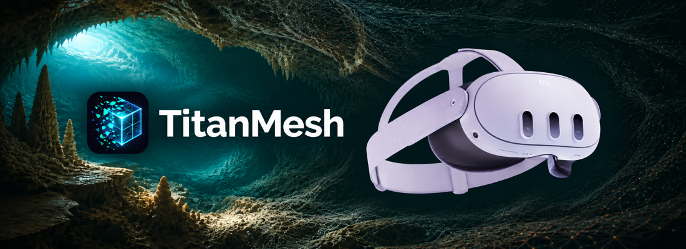

# TitanMesh

## Explore large 3D scans. Discover the detail. Share the view.

TitanMesh turns complex meshes and point clouds into places you can explore.
Move through a photogrammetry reconstruction, inspect a LiDAR survey, measure a
feature, or take someone on a recorded tour. Bring your model into focus on
Windows, macOS, or Linux, then step inside it with optional Meta Quest viewing.

[**Download TitanMesh**](https://github.com/OpenSpeleo/TitanMesh-Releases/releases/latest)
·
[**Start a free 48-hour trial**](https://software.usahinstitute.org/free-trial)
· [**Licenses and pricing**](https://software.usahinstitute.org/pricing)

## Why TitanMesh

Modern photogrammetry, LiDAR, and large-scale scanning can produce tens of
millions to billions of triangles or points. These datasets can exceed a
computer's RAM, let alone its graphics memory. At that scale, long loading
times, memory limits, and sluggish navigation can turn a valuable scan into
something difficult to explore.

TitanMesh is built for that challenge. Its focus is making large 3D datasets
practical to navigate and inspect, including meshes and point clouds larger than
your computer's system or graphics memory. Multi-gigabyte models become spaces
you can move through: fly across the scene, approach a feature, orbit it, and
stop to investigate. Familiar game-style controls put the exploration in your
hands.

That focus shapes the whole experience. Navigation, calibrated measurements,
landmarks, recorded tours, and optional VR help you move from seeing a model to
understanding the place it represents.

**The goal is simple: make exploring a massive 3D scan feel as natural as flying
through a level in a game.**

## See more of your 3D data

A scan captures a place. TitanMesh helps you explore it, understand it, and show
others what matters.

- **Explore at scale.** Open large meshes and point clouds, including datasets
  that exceed your computer's system or graphics memory.
- **Move naturally.** Fly through a scene, orbit a detail, change your pace, and
  return to the starting view with familiar game-style controls.
- **Inspect with purpose.** Calibrate distances, place measurements, and mark
  important locations with named landmarks and notes.
- **Present your perspective.** Record a camera route, replay a tour, save a
  clean snapshot, or capture the application to MP4.
- **Step inside the model.** Explore on Meta Quest 3 or Quest 3S while someone
  follows your viewpoint on the desktop.

TitanMesh is built for viewing large 3D datasets. Model size, complexity,
hardware, and display settings affect preparation time and performance.

## Explore with confidence

Move from a view of the whole model to a closer look at the details. Free-flight
navigation, mouse look, a movement boost, and adjustable speed let you set the
pace. Orbit controls work with a mouse or trackpad, and a minimap helps you keep
track of your position and direction.

A playable tutorial introduces the controls. Downloadable demo models give you a
place to start before opening your own scans. Choose fullscreen for an immersive
desktop view or a resizable window for working alongside other tools.

## Make the details easier to read

View textured meshes, vertex colors, and shaded surfaces where supported by the
source file. Adjust point size to make point-cloud structure easier to inspect.
For compatible PLY files, confidence filtering helps you hide samples below your
chosen confidence level.

Tune detail quality, edge smoothing, model orientation, and triangle-face
visibility to suit the scene. Temperature, Tint, Vibrance, and Saturation
controls let you refine its appearance with live feedback. These viewing
adjustments leave your source model unchanged.

## Measure, mark, and return

Desktop's **Scientific Mode** brings practical inspection tools into the model.
Calibrate against a known distance, place measurement endpoints on surfaces, and
read distances in metric or imperial units. Adjust an endpoint, revise the
calibration, or remove an individual measurement as your inspection develops.

Add landmarks with titles and descriptions to identify features, observations,
and places worth revisiting. Measurement annotations and landmarks remain
visible through model surfaces, helping you keep important references in view.

Saved calibration, measurements, landmarks, and model preferences let you pick
up an inspection when you reopen the same model. You can also export the minimap
as a transparent PNG for use in a report or presentation.

## Turn exploration into a tour

**Flight Recorder and Flight Replay** let you capture a camera route and return
to it. Record a path through the model, save it, and replay it once or on a
loop. Adjust the travel speed to suit a close inspection or a broader
presentation.

Replay works on Desktop and in VR. In a headset, the route guides your movement
while you remain free to look around. Use the same route to introduce a site,
revisit a feature, or guide someone through a complex scene.

## Capture what matters

Use **Capture** for snapshots and video, and **File** for saved locations.
Choose the format that suits your next conversation or presentation:

- **Snapshots:** save a clean, watermarked JPEG of the model view, without menus
  or inspection overlays. A TitanMesh snapshot can also restore its saved
  viewpoint when the corresponding model is open.
- **Saved locations:** share a lightweight viewpoint file with someone who has
  the same model, or return to that view yourself.
- **MP4 recording:** record the TitanMesh window, including visible annotations
  and interface elements. Capture a live exploration or a replayed flight
  without a separate recording application. Video recording does not include
  audio.

## Experience your model in VR

Explore on **Meta Quest 3 and Quest 3S** with tracked controllers, guided setup,
and a QR connection to your computer. Move, turn, change elevation, orbit a
feature, and confirm a return to the starting location from inside the scene.

The headset menu gives you control over movement speed, detail quality, visual
smoothing, and point size where applicable. Desktop and VR retain independent
speed, quality, and smoothing preferences, so you can tune each experience to
its user.

The desktop follows the headset's viewpoint during a session, making it easy for
a colleague to follow along. A built-in network speed test helps you check the
local connection before opening a model in VR.

VR viewing requires the TitanMesh headset app, optional VR access on your active
Desktop license, and a computer and headset on the same local network. Setup and
headset-app download guidance are available from TitanMesh's **VR** menu.
Measurement and landmark tools are Desktop features.

## Bring your existing models

| Format     | Meshes | Point clouds | Appearance                                            |
| ---------- | :----: | :----------: | ----------------------------------------------------- |
| OBJ        |  Yes   |     Yes      | Vertex colors, materials, and textures when available |
| Binary STL |  Yes   |      —       | Surface shading                                       |
| Binary PLY |  Yes   |     Yes      | Vertex colors and supported surface information       |
| GLB / glTF |  Yes   |     Yes      | Vertex colors, materials, and textures when available |

STL and PLY files must use a supported binary encoding. Convert text-based STL
or PLY files to binary before opening them. Appearance support depends on the
format and the information present in the source file.

## Get started

1. **Download and install TitanMesh** for your platform.
2. **Activate a license or start a 48-hour trial.** Follow the navigation
   tutorial to get familiar with the controls.
3. **Open a demo or your own model.** Use **File > Open Model**, the open-file
   shortcut, or drag and drop a supported model into the application.

### Choose your installer

| Platform    | Download                                          | Installation                                                                                |
| ----------- | ------------------------------------------------- | ------------------------------------------------------------------------------------------- |
| macOS       | Universal `.dmg` for Apple Silicon and Intel Macs | Open the disk image and drag TitanMesh into Applications.                                   |
| Windows x64 | `setup.exe` or `.msi`                             | Run the installer and follow the prompts.                                                   |
| Linux x64   | `.AppImage` or `.tar.gz`                          | Make the AppImage executable and launch it, or extract the archive for manual installation. |

Find installers and release notes on the
[Releases page](https://github.com/OpenSpeleo/TitanMesh-Releases/releases).
TitanMesh also checks for signed updates inside the application.

Use compatible graphics hardware and current drivers. An SSD and sufficient free
disk space for your models and working files are recommended. The trial lets you
evaluate TitanMesh with your own datasets and computer before choosing a
license. On macOS, window recording requires the operating system's
screen-recording permission.

## Licensing and support

TitanMesh is commercial software. Visit the
[licensing portal](https://software.usahinstitute.org/) to manage your license,
explore pricing, or request a free 48-hour trial. VR viewing requires optional
VR access in addition to the Desktop license and headset app.

Internet access is required for activation and periodic license validation.
Limited offline use is available after successful validation.

For product or installation support, use the support channel supplied with your
purchase or license. Include your TitanMesh version, operating system, and a
short description of the issue. Keep license keys and private datasets out of
public issue reports.

**Ready to explore your scans?**
[Download TitanMesh](https://github.com/OpenSpeleo/TitanMesh-Releases/releases/latest)
and [start your trial](https://software.usahinstitute.org/free-trial).

---

This public repository distributes TitanMesh installers, release notes, and
update files. TitanMesh is proprietary software; its source code is private.
Downloading an installer does not grant a license. Use is governed by the
applicable commercial license agreement. Bundled third-party components remain
subject to their respective licenses.
